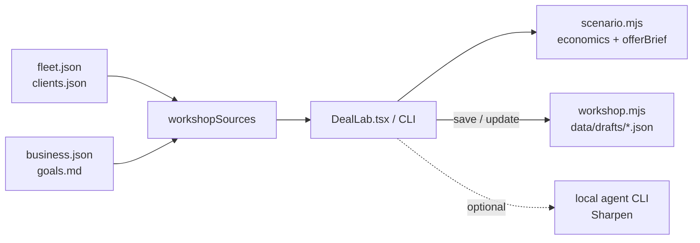

# Deal Lab

An offer simulator for a small app studio that charges a one-time build fee plus a monthly retainer. Pick a finished app or prospect, move the pricing and capacity sliders, see how many retainers close the gap to your revenue target, and leave with an editable offer brief.

It was built as the Business tab of [Omega](https://github.com/ianroyes-sys), Ian's local dashboard, and is published here as a standalone core (zero-dependency Node modules, a CLI and tests) plus the extracted Next.js components and API routes.

## Why

When you sell custom apps, the hard question is rarely "can I build it". It's "what do I charge, how many of these can I support, and what do I say in the next meeting". Deal Lab answers that with your own numbers, and is strict about honesty: scenarios are labeled as scenarios, a recorded ledger older than seven days is treated as unverified, and a demo is never counted as a client.

## Features

- **Scenario economics**: build fee, retainer, direct cost and support hours per client, available hours, target and baseline MRR give you new MRR, retainers still needed, monthly contribution, one-time build revenue and a support-capacity check.
- **Offer brief generator**: turns the selected project plus the scenario into a Markdown working draft (opportunity, scope, pricing, open questions, next conversation). Nothing is ever sent.
- **Saved drafts with optimistic concurrency**: drafts are JSON files written atomically (`0600`); an update must carry the current revision, so two browser windows cannot silently overwrite each other. Export any draft as `.md`.
- **Input validation that blocks misleading math**: zero retainers or support hours, negative baselines, fractional client counts and path-traversal IDs are rejected.
- **Optional "Sharpen" pass**: the Next.js route can hand the brief to a local agent CLI (`claude -p` by default) with a prompt that forbids invented clients, results or guarantees.

## How it works



The core lives in `src/` as plain ES modules with no dependencies. The UI in `omega-ui/` imports those same modules, so the browser, the CLI and the tests share one implementation of the math.

The pipeline and fleet board from the same Business tab ("The Desk") lives in its own repo: [the-desk-pipeline-board](https://github.com/ianroyes-sys/the-desk-pipeline-board).

## Tech stack

- Node.js 20+ (ES modules, `node:test`), no runtime dependencies
- Next.js App Router + React + CSS Modules for the UI layer (`omega-ui/`)
- Local JSON files for data and drafts

## Getting started

```bash
git clone https://github.com/ianroyes-sys/deal-lab-offer-simulator.git
cd deal-lab-offer-simulator
npm test                                   # 9 tests

node bin/deal-lab.mjs sources              # project inventory + revenue mission
node bin/deal-lab.mjs scenario --retainer 150 --clientCount 4 --source client:harbor-bakery
```

To use your own data, copy the example files into `data/` (ignored by git) and edit them:

```bash
cp data/example/*.json data/example/goals.md data/
```

### Using the UI

`omega-ui/` is not a full app. Drop it into a Next.js App Router project:

1. Copy `omega-ui/components/*` into your components folder and `omega-ui/app/api/workshop` into `app/api/`. Keep `src/` reachable at the relative paths the files import (or adjust them).
2. Set the variables from `.env.example`. `DEAL_LAB_KEY` is required: the routes reject requests without a matching `deal_lab_key` cookie or `x-deal-lab-key` header, and reject cross-origin writes.
3. Render `<DealLab />`.

## Project structure

```
src/
  scenario.mjs      Offer economics + Markdown brief template
  workshop.mjs      Project inventory, mission, draft save/read/list/export
  *.test.mjs        node:test suites
bin/deal-lab.mjs    CLI: sources | scenario | drafts
data/example/       Fictional fleet, clients, ledger and goal
omega-ui/
  components/       DealLab.tsx + CSS module
  app/api/workshop/ GET/POST/PUT drafts, POST generate (local agent)
  lib/guard.ts      Shared-key + same-origin guard for the routes
  types.d.ts        Type shims for the .mjs core
```

## Status

The core modules and CLI run standalone and are covered by tests. The UI runs inside Ian's local Omega dashboard; in this repo it is extracted source that needs a Next.js host, and it type-checks under strict TypeScript against Next.js and React types, but it has not been built here as a separate app. All bundled data is fictional.

Built by [Ian Royes](https://github.com/ianroyes-sys)
